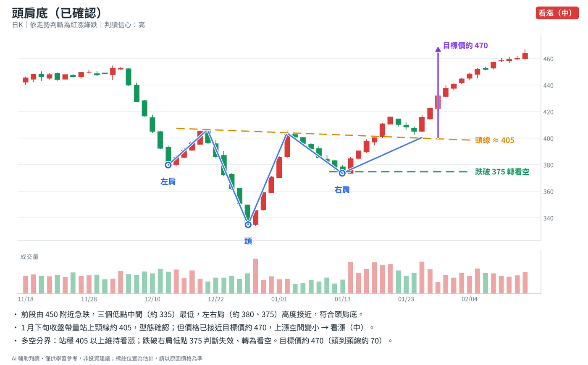
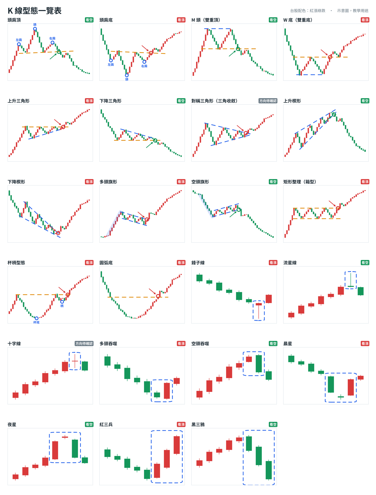

# K 線型態判讀（kline-pattern-analyzer）

給 Claude 用的 Skill。丟一張 K 線截圖，Claude 會自動完成判讀：

- **判斷型態**：從 23 種常見型態裡找出符合的，並標明目前是形成中、已確認還是失敗。
- **給方向結論**：七級之一，看漲（強／中／弱）、中性（等突破）、看空（弱／中／強）。
- **給多空分界**：「站上 X 看漲成立」「跌破 Y 判斷失效」兩個價位，已確認的型態另附目標價。
- **產生兩張圖**：一張在你的原圖上標註，一張標準型態示意圖。



> 範例圖為模擬走勢。所有判讀僅供技術分析學習，不構成投資建議。

---

## 安裝

依你用的 Claude 選一種方式。

### 方法一：請你的 AI 幫你安裝（Claude Code、Claude 桌面版的 Code 分頁）

開啟 Claude Code，貼上這段話：

```
請幫我安裝這個 Claude skill：https://github.com/ShabiSung/kline-pattern-analyzer
照 README 裡「給 AI 的安裝步驟」做，裝好後告訴我怎麼用。
```

AI 會自己完成下載、安裝與測試。裝好後，**重新開啟 Claude Code** 才會生效。

### 方法二：claude.ai 網頁版或 App

claude.ai 裡的 AI 無法修改你的帳號設定，所以這一步要自己做：

1. 下載 **[kline-pattern-analyzer.zip](https://github.com/ShabiSung/kline-pattern-analyzer/releases/latest/download/kline-pattern-analyzer.zip)**，不用解壓縮。
2. 到 **設定 › 功能（Capabilities）**，開啟「程式碼執行與檔案建立」。
3. 在同一頁的 **Skills** 區塊按「上傳 Skill」，選擇剛剛的 zip。
4. 開新對話測試：「畫一張頭肩底的型態示意圖給我」，看到圖就代表成功。

> 介面文字可能因版本略有不同。你的方案需要能使用 Skills 功能。

---

## 使用方式

上傳（或在 Claude Code 中拖曳）K 線截圖，然後問：

```
這是台股 2330 的日 K，紅漲綠跌。這是什麼型態？看漲還是看空？幫我在圖上標出來。
```

```
這是 BTC 的 4 小時 K，綠漲紅跌。判斷型態和多空方向，並給我多空分界價位。
```

其他問法：

- **多週期**：「這是同一檔的日 K 和週 K，綜合起來看漲還是看空？」
- **追問**：「站上哪裡才算轉多？跌破哪裡判斷就失效？」「為什麼是『中』不是『強』？」
- **查型態**：「什麼是杯柄型態？畫示意圖給我。」「給我全部型態的一覽表。」

截圖小技巧：

- 日 K 至少 3–6 個月。
- 保留價格刻度與成交量。
- 不要裁掉最右邊最新的 K 棒。
- 在訊息裡寫出標的、週期，以及紅漲綠跌或綠漲紅跌。

---

## 支援的型態

| 類別 | 型態 |
|---|---|
| 反轉 | 頭肩頂、頭肩底、M 頭（雙重頂）、W 底（雙重底）、上升楔形、下降楔形、圓弧底 |
| 中繼整理 | 上升三角形、下降三角形、對稱三角形、多頭旗形、空頭旗形、矩形整理（箱型）、杯柄型態 |
| K 線組合 | 錘子線、流星線、十字線、多頭吞噬、空頭吞噬、晨星、夜星、紅三兵、黑三鴉 |



---

## 給 AI 的安裝步驟

> 這一節寫給幫使用者安裝的 AI 助理（例如 Claude Code）。請依序執行，每一步確認成功再繼續；完成後用一兩句話告訴使用者結果與用法。

### 1. 安裝 skill（擇一）

**方式 A：用 Claude Code 外掛安裝（優先）**。可以執行 `claude` 指令時：

```bash
claude plugin marketplace add ShabiSung/kline-pattern-analyzer
claude plugin install kline-pattern-analyzer@kline-course
```

**方式 B：直接複製到個人 skills 資料夾**。方式 A 失敗時使用。

macOS／Linux：

```bash
git clone --depth 1 https://github.com/ShabiSung/kline-pattern-analyzer.git /tmp/kline-pattern-analyzer
mkdir -p ~/.claude/skills
rm -rf ~/.claude/skills/kline-pattern-analyzer
cp -R /tmp/kline-pattern-analyzer/skills/kline-pattern-analyzer ~/.claude/skills/
```

Windows（PowerShell）：

```powershell
git clone --depth 1 https://github.com/ShabiSung/kline-pattern-analyzer.git "$env:TEMP\kline-pattern-analyzer"
New-Item -ItemType Directory -Force "$HOME\.claude\skills" | Out-Null
Remove-Item -Recurse -Force "$HOME\.claude\skills\kline-pattern-analyzer" -ErrorAction SilentlyContinue
Copy-Item -Recurse "$env:TEMP\kline-pattern-analyzer\skills\kline-pattern-analyzer" "$HOME\.claude\skills\"
```

### 2. 安裝 Python 套件

```bash
python3 -m pip install matplotlib numpy        # Windows: py -m pip install matplotlib numpy
```

出現 `externally-managed-environment` 錯誤時，改用虛擬環境：

```bash
python3 -m venv ~/.kline-venv && ~/.kline-venv/bin/pip install matplotlib numpy
```

### 3. 驗證

先找到 skill 的位置：

- 方式 A：在 `~/.claude/plugins/cache/` 底下
- 方式 B：在 `~/.claude/skills/kline-pattern-analyzer`

然後產生一張測試圖：

```bash
SKILL=$(dirname "$(find ~/.claude -name draw_pattern.py -path '*kline-pattern-analyzer*' | head -1)")/..
python3 "$SKILL/scripts/draw_pattern.py" head_shoulders_bottom -o kline-test.png
```

看到 `kline-test.png` 產生就代表成功。若用了虛擬環境，把 `python3` 換成 `~/.kline-venv/bin/python`。

### 4. 告訴使用者

- 請重新開啟 Claude Code，skill 才會載入。
- 用法：把 K 線圖檔拖進終端機，並問「這是什麼型態？看漲還是看空？」

---

## 檔案結構

```
.claude-plugin/              Claude Code 外掛與 marketplace 設定
skills/kline-pattern-analyzer/
  SKILL.md                   判讀流程與規則
  references/                型態辨識條件
  scripts/                   標註與示意圖腳本
  assets/fonts/              Noto Sans TC（SIL Open Font License 1.1）
```

## 免責聲明

本 Skill 與 AI 判讀結果僅供技術分析學習使用，不構成任何投資建議。型態可能失敗，任何交易前請自行評估風險並設定停損。
