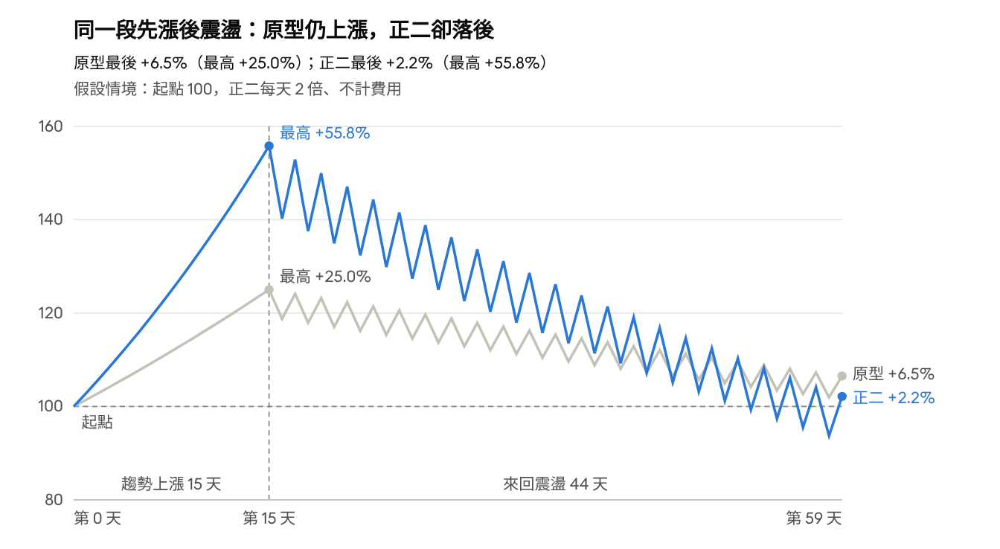

# 0050 上漲，正二為什麼反而落後？

2026/11/03 整理 ｜ [下載 PDF 版](pdf/leveraged-etf-vs-0050.pdf)

2026/05/04–2026/11/03（還原股價、含息），0050 上漲 6.99%，00631L 只有 1.55%。正二追求的是「每日」約 2 倍報酬，不是「整段期間」2 倍；遇到高波動、反覆漲跌的路徑，槓桿的複利損耗就會吃掉報酬。

## 數據一覽

直覺會以為 0050 漲 7%，正二應該漲 14% 左右；實際只有 1.55%，不到 0050 的四分之一。

| 指標（2026/05/04–11/03） | 00631L（正二） | 0050（原型） | 正二 ÷ 0050 |
| --- | --- | --- | --- |
| 區間報酬（含息） | +1.55% | +6.99% | 0.22 倍 |
| 期間最高漲幅 | 約 +35% | 約 +24% | 約 1.5 倍 |
| 年化標準差 | 61.33% | 31.29% | 1.96 倍 |
| 最大跌幅 | −31.32% | −15.37% | 2.04 倍 |

兩者的最大跌幅發生在差不多同一段期間：0050 從高點跌約 15% 時，正二已經回撤超過 30%。

## 觀念一：每日 2 倍，不等於整段期間 2 倍

正二每天重新調整曝險，只追求「當天」報酬接近 0050 的 2 倍。整段期間的結果取決於每天漲跌的順序，這叫「路徑相依」。

兩天試算（不計費用）：

| 情境 | 0050 每日 | 0050 結果 | 正二每日 | 正二結果 | 直覺（0050 × 2） |
| --- | --- | --- | --- | --- | --- |
| 一路上漲 | +10%、+10% | +21% | +20%、+20% | +44% | +42% |
| 先跌再漲 | −10%、+11.1% | 0%（回到 100） | −20%、+22.2% | −2.2% | 0% |

- **順風時**：每日複利讓正二賺得比 2 倍還多。
- **震盪時**：從 100 跌到 90，要漲 11.1% 才回得去。槓桿把這個「先跌再漲」的損耗也放大，0050 回到原點，正二還虧 2.2%。
- **震盪越劇烈、漲跌越頻繁**，損耗越明顯。這半年就是先大漲、再明顯震盪回檔的路徑。

## 示意圖：震盪怎麼磨掉正二的報酬

*假設情境，非實際股價 · 前 15 天每天 +1.5%，之後 44 天 −5%、+4.5% 交替 · 不計經理費與轉倉成本*

前段一路上漲時，正二賺得比 2 倍還多；進入震盪後，原型只小幅回落，正二卻被每天的來回漲跌磨掉大半獲利，最後反而落後原型。這和 00631L 這半年的情況是同一個道理。

## 觀念二：放大的不只報酬，還有波動與回撤

這半年正二的年化標準差與最大跌幅，都是 0050 的約 2 倍；報酬則只有 0.22 倍。

- **波動**：61.33% 對 31.29%。
- **最大跌幅**：−31.32% 對 −15.37%，而且發生在差不多同一段期間。
- **帳面體感**：正二一度賺到約 +35%，最後只剩 +1.55%。要先問自己：這樣一路掉下來，還拿不拿得住？

## 觀念三：期貨轉倉與其他持有成本

今年部分月份台指期的跨月正價差，讓正二多了一層轉倉拖累；但這半年落後的核心仍是高槓桿遇上高波動與不友善的路徑。

1. **曝險來源**：00631L 不是單純借一倍的錢買 0050，很大一部分曝險透過台指期建立。
2. **轉倉怎麼扣血**：遠月期貨比近月貴（跨月正價差）時，換月等於賣掉便宜的近月、再買進較貴的遠月。
3. **精確的說法**：不是「期貨價格比現貨高」就一定扣血。真正影響基金的是實際持有的契約、換月時點，以及近遠月的價差。
4. **其他成本**：經理費、交易成本與追蹤成本。所以長期結果不可能剛好等於 0050 累積報酬 × 2。

## 正二喜歡與不喜歡的環境

正二需要的不只是「最後有漲」，而是「用對的方式漲」。

| 因素 | 對正二有利 | 對正二不利 |
| --- | --- | --- |
| 長期報酬 | 夠高 | 偏低 |
| 趨勢 | 上漲趨勢強、方向明確 | 反覆漲跌、沒有方向 |
| 波動 | 中間震盪不劇烈 | 波動維持高檔 |
| 期貨期限結構 | 對多頭部位不扣血 | 長期跨月正價差，轉倉持續扣血 |

有利條件同時成立時，正二可能快速拉開與 0050 的差距；不利條件疊在一起時，就可能像這半年一樣，0050 賺錢、正二大幅落後。

## 過去十年與這半年：兩面一起看

兩段歷史都是真的，但都只是一條路徑；未來的路徑沒有人能事先知道。

| 期間 | 發生了什麼 | 告訴我們 | 不能推出 |
| --- | --- | --- | --- |
| 過去十年 | 長期強勢上漲、大型權值股領漲。講者先前試算：最近 2,500 個交易日，100 萬元最後接近 4,000 萬元 | 市場順風時，正二可以有多驚人 | 未來十年會複製同樣結果 |
| 這半年 | 先漲到約 +35%，再震盪回檔到 +1.55%；0050 仍有 +6.99% | 路徑不順時，結果可以和直覺差非常多 | 「正二果然不能長期持有」，半年時間太短 |

評估正二，不能只用一句「台股長期向上」就把風險講完。你承擔的不只是「市場最後有沒有上漲」，還包括「市場用什麼方式上漲」。

## 評估正二前的自我檢查

不要只問「過去報酬有多高、有多輾壓 0050」，這五題要一起回答：

- [ ] 波動有多大？
- [ ] 最大跌幅有多深？0050 跌 15% 時，正二可能跌超過 30%。
- [ ] 市場是一路趨勢上漲，還是反覆震盪？
- [ ] 期貨長期是補血，還是扣血？
- [ ] 帳面從 +35% 一路掉到只剩 +1%，你還拿不拿得住？

正二可以是很強的工具，但槓桿沒有免費午餐：更高的上漲曝險，換來的是更大的波動、更深的回撤、期貨期限結構的不確定性，以及路徑相依。

*本講義僅供投資教學，不構成任何投資建議。*
