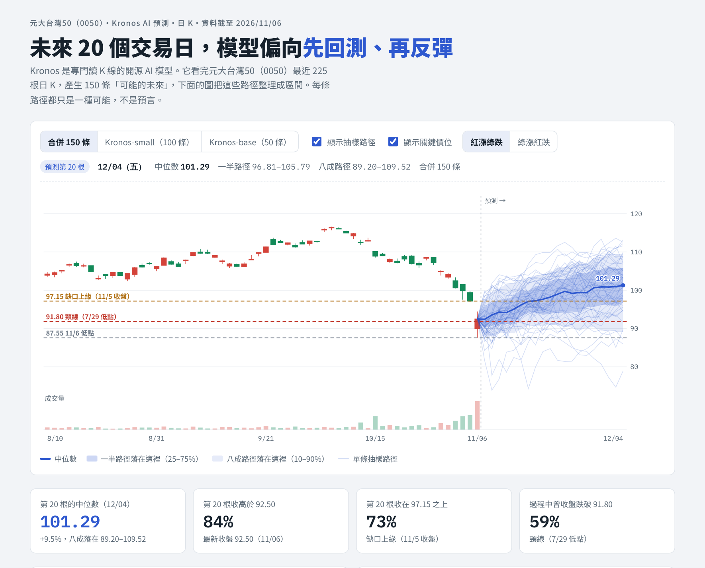

# Kronos 預測報告（kronos-forecast）

給 Claude Code 用的 Skill。用開源的 K 線 AI 模型 [Kronos](https://github.com/shiyu-coder/Kronos) 預測股票、ETF、加密貨幣未來的走勢，最後產生一份互動網頁報告。

裝好之後，只要對 Claude 說「用 Kronos 預測 0050」：

1. **先教學**：第一次使用時，Claude 會邊做邊解釋 Kronos 是什麼、怎麼看預測區間、模型有哪些限制。
2. **自動完成**：安裝環境、下載資料、跑預測，全部由 Claude 處理。
3. **產生報告**：輸出互動網頁報告，可以切換模型、看每天的預測區間、關鍵價位和統計數字。能發布 artifact 時，會直接給你分享連結。



> 範例為 0050 在 2026/11/06 的預測。想看可以操作的完整版，下載 [example-report.html](https://github.com/ShabiSung/kline-pattern-analyzer/raw/main/plugins/kronos-forecast/docs/example-report.html) 用瀏覽器打開。所有預測僅供研究與教學，不構成投資建議。

---

## 需要什麼

- **Claude Code**：Claude 要能在你的電腦上執行 Python。claude.ai 網頁版無法安裝 PyTorch，不能用這個工具。
- **Python 3.9–3.13**：沒有的話到 python.org 下載 3.12。
- **硬碟空間約 2–6 GB**：PyTorch 加上模型，Linux 版 PyTorch 比較大。
- **網路**：第一次安裝要下載 PyTorch 和約 500 MB 的模型。

## 安裝

開啟 Claude Code，貼上這段話：

```
請幫我安裝 Kronos 預測工具：https://github.com/ShabiSung/kline-pattern-analyzer/tree/main/plugins/kronos-forecast
照 README 裡「給 AI 的安裝步驟」做，裝好後教我怎麼用。
```

Claude 會完成安裝並帶你跑第一次預測。第一次大約要 10–20 分鐘，大部分時間花在下載 PyTorch 和模型。

## 使用方式

直接用自然的話問 Claude：

```
用 Kronos 預測 0050 未來 20 個交易日，做成報告給我。
```

```
用 Kronos 預測 BTCUSDT 的 4 小時 K，接下來 30 根，small 和 base 兩個模型都跑。
```

```
這是我從看盤軟體匯出的 6488 日 K（附上 CSV），幫我用 Kronos 預測下個月。
```

支援的資料來源：

| 標的 | 資料來源 |
|---|---|
| 台股上市股票、ETF | 臺灣證券交易所日 K，自動還原股票分割 |
| 加密貨幣 | 幣安（Binance）現貨，1 小時、4 小時、日 K 等 |
| 美股與其他市場 | Yahoo 財經，偶爾會被限流 |
| 台股上櫃，或任何市場 | 自己匯出的 CSV，欄位要有日期和開高低收，成交量可有可無 |

## 報告裡有什麼

- **K 線與預測區間**：最近 60 根 K 線，接上未來每一根的中位數，以及 25–75%、10–90% 兩層區間。
- **抽樣路徑**：模型每次預測都像擲一次骰子，100 條路徑代表 100 種可能的走勢。
- **四個統計數字**：
  - 最後一根的中位數
  - 收高於最新收盤的比例
  - 站上壓力價位的比例
  - 過程中曾跌破支撐價位的比例
- **互動功能**：
  - 切換 Kronos-small、Kronos-base 或兩者合併
  - 滑鼠移到圖上看每一根的數字
  - 切換紅漲綠跌和綠漲紅跌

## 使用前要知道

- **只看價量**：Kronos 只看價格和成交量，不知道新聞、財報和突發事件。
- **比例不是機率**：報告的百分比是「抽樣路徑裡有幾條這樣走」，不是校準過的真實機率。
- **沒有保證準確**：預測可能完全錯誤，請當作第二意見，搭配技術面與停損一起使用。

---

## 給 AI 的安裝步驟

> 這一節寫給幫使用者安裝的 AI 助理（例如 Claude Code）。請依序執行，每一步確認成功再繼續。

### 1. 安裝 skill（擇一）

**方式 A：Claude Code 外掛（優先）**

```bash
claude plugin marketplace add ShabiSung/kline-pattern-analyzer
claude plugin install kronos-forecast@kline-course
```

已經加過這個 marketplace 的話，先執行 `claude plugin marketplace update kline-course`。

**方式 B：直接複製到個人 skills 資料夾**（方式 A 失敗時）

macOS／Linux：

```bash
git clone --depth 1 https://github.com/ShabiSung/kline-pattern-analyzer.git /tmp/kline-course
mkdir -p ~/.claude/skills
rm -rf ~/.claude/skills/kronos-forecast
cp -R /tmp/kline-course/plugins/kronos-forecast/skills/kronos-forecast ~/.claude/skills/
```

Windows（PowerShell）：

```powershell
git clone --depth 1 https://github.com/ShabiSung/kline-pattern-analyzer.git "$env:TEMP\kline-course"
New-Item -ItemType Directory -Force "$HOME\.claude\skills" | Out-Null
Remove-Item -Recurse -Force "$HOME\.claude\skills\kronos-forecast" -ErrorAction SilentlyContinue
Copy-Item -Recurse "$env:TEMP\kline-course\plugins\kronos-forecast\skills\kronos-forecast" "$HOME\.claude\skills\"
```

### 2. 安裝 Kronos 執行環境

先找到 skill 的位置：
- 方式 A：在 `~/.claude/plugins/` 底下
- 方式 B：在 `~/.claude/skills/kronos-forecast`

然後執行安裝腳本。它會在 `~/.kronos-forecast/` 建立虛擬環境、下載 Kronos 原始碼和模型，最後跑一次測試預測。

```bash
SKILL=$(dirname "$(find ~/.claude -name setup_kronos.py -path '*kronos-forecast*' | head -1)")/..
python3 "$SKILL/scripts/setup_kronos.py"
```

Windows 把 `python3` 換成 `py`。

- 這一步要 5–15 分鐘，能放背景執行就放背景，並向使用者回報進度。
- 看到「測試預測 OK」和「安裝完成」就代表成功。
- 失敗時參考 SKILL.md 的「疑難排解」。

### 3. 告訴使用者

- 請重新開啟 Claude Code，skill 才會載入。
- 用法：對 Claude 說「用 Kronos 預測 0050，做成報告給我」。第一次使用時 Claude 會先教學。

---

## 檔案結構

```
.claude-plugin/plugin.json       外掛設定
skills/kronos-forecast/
  SKILL.md                       操作流程與回覆格式
  references/teaching.md         第一次使用的教學腳本
  scripts/setup_kronos.py        安裝 Kronos、PyTorch 與模型
  scripts/fetch_data.py          下載或整理 K 線資料
  scripts/forecast.py            產生抽樣路徑
  scripts/build_report.py        產生互動 HTML 報告
  assets/report_template.html    報告樣板
docs/example-report.png          報告範例截圖
docs/example-report.html         報告範例（可用瀏覽器打開）
```

## 授權與致謝

- Kronos 模型與原始碼由 [shiyu-coder/Kronos](https://github.com/shiyu-coder/Kronos) 提供，採 MIT 授權。本工具不包含 Kronos 的程式碼，安裝時才從原專案下載。
- 台股資料來自臺灣證券交易所公開資訊，加密貨幣資料來自 Binance 公開 API，美股資料來自 Yahoo 財經。使用時請遵守各網站的使用規範。

## 免責聲明

本工具與 AI 預測結果僅供研究與教學使用，不構成任何投資建議。預測可能完全錯誤，任何交易前請自行評估風險並設定停損。
